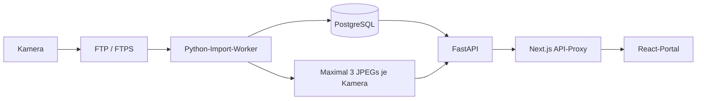

# Architektur · Fillens 0.5.1

## Komponenten

`frontend`: Next.js 16, React 19, TypeScript strict, Tailwind 4, shadcn/ui-Button auf Radix, Recharts und Lucide. Eine angemeldete Portaloberfläche bietet die Mehrbehälter-Übersicht mit gemeinsamer Messungsansicht und Anlagen; Admins zusätzlich Training, Benutzer und System; Meldungen für alle angemeldeten Benutzer. Navigation innerhalb des Portals ist clientseitig. Die Admin-Trainingsseite ist auch direkt unter /training erreichbar.

`backend`: synchrones FastAPI, SQLAlchemy 2, Psycopg 3 und Alembic. Ausschließlich relative öffentliche API-Pfade. Der Next.js-Proxy spricht die API serverseitig an und reicht HttpOnly-Cookies und CSRF-Header weiter. Keine CORS-Freigabe, kein direkt öffentlicher API-Port in Compose.

`worker`: eigener Prozess, kein Scan im Webrequest. Rekursive FTP-/FTPS-Scans, begrenzte Downloads im RAM, Pillow-Validierung/Normalisierung, Metadatenjournal, Pufferpflege und Status. Lokale Bildanalyse nach ausdrücklicher Modellaktivierung. Jeder Kameraimport läuft getrennt; ein Verbindungsfehler blockiert die übrigen Kameras nicht.

`postgres`: PostgreSQL 17 mit persistentem Datenvolume. `image_data` enthält ausschließlich den kurzlebigen Bildpuffer und die Worker-Sperrdatei. Das Backend bindet diesen Speicher nur lesend ein. Keine externe Cloud- oder Supabase-Abhängigkeit, keine Zahlungslogik.

## Datenmodell

| Tabelle | Zweck |
|---|---|
| `users` | E-Mail, Argon2-Passworthash, aktive Rolle, letzte Anmeldung |
| `auth_sessions` | SHA256 des Zufallstokens, CSRF-Hash, Benutzer, Ablaufzeit |
| `login_attempts` | Gehashter Kontobezeichner und Zeit für das Datenbank-Ratelimit |
| `sites` | Standorte und Zeitzonen |
| `containers` | Standort, Kapazität, Einheit, Füll-/Verbrauchsanzeige, Aktivstatus |
| `ftp_connections` | Verbindung und mit Fernet verschlüsseltes Passwort |
| `cameras` | Eine Kamera pro Behälter, FTP-Zuordnung, relativer Root, Ausrichtung und Importstatus |
| `import_records` | Dauerhaftes Journal ohne Bildbytes; Dateiversion und Inhalts-Hash zur Deduplizierung |
| `image_buffer` | Zeitlich aufbewahrte Kameraaufnahmen ohne Anzahlgrenze; Verknüpfung zur Lernreferenz, lokaler Aufnahmezeitpunkt und Nachholstatus; neueste Vorschau geschützt |
| `measurements` | Dauerhafte Füllstände, historische Kapazität/Einheit, absolute Menge, Änderungsraten, Herkunft und Ersteller |
| `worker_status` | Letztes Lebenszeichen des Importers |

Behälter und Kameras werden deaktiviert statt samt Historie gelöscht. Es existieren keine öffentlichen Löschendpunkte für Stammdaten oder Messwerte. Benutzerdeaktivierung widerruft Sitzungen. Rollen gelten installationsweit; mandantenspezifische Standortrechte sind noch nicht vorgesehen.

## Pufferinvariante und Absturzverhalten

Nur der Worker schreibt Produktivbilder. Eine Dateisperre auf dem gemeinsamen Speicher sowie ein PostgreSQL-Advisory-Lock verhindern doppelte Worker. Metadaten-/Hash-Deduplizierung erfolgt vor dem Anlegen eines neuen Puffereintrags. Vor einer vierten neueren Aufnahme wird die älteste nach Aufnahmezeit gelöscht; historische Kontrollfunde verdrängen keine neueren Bilder. Dateien erhalten ausschließlich lokal erzeugte UUID-Namen; Remote-Pfade sind niemals lokale Dateipfade.

Dateisystem und Datenbank bilden keine gemeinsame Transaktion. Deshalb gilt die Reihenfolge **zuerst alte Datei entfernen, dann neue Datei schreiben und Metadaten committen**. So entstehen auch vorübergehend keine vier lokalen Produktivbilddateien. Bei einem Absturz kann ein veralteter DB-Eintrag auf eine fehlende Datei zeigen oder eine unreferenzierte Datei verbleiben. `reconcile` bereinigt beides beim nächsten Kamera-Scan. Ein Bildzugriff auf eine fehlende Datei antwortet mit 410, ein bereits entfernter Datensatz mit 404. Ein bestehender Messwert bleibt in beiden Fällen erhalten. Für den Produktivpuffer wird kein Archiv angelegt. Seit 0.4.0 können bei aktivem Lernen analysierte Referenzbilder im getrennten Trainingsspeicher behalten und als Thumbnails/Lightbox angezeigt werden.

Der exklusive Worker übernimmt neue Kamerabilder unabhängig von Analyse und Modell in den ML-Speicher. `training_store` verwaltet Nachholen, zeitliche Aufbewahrung und geschützte Referenzen. DB-/Dateiabgleich entfernt fehlende oder verwaiste Dateien ohne feste Anzahlbegrenzung. Kameraimporte und Lernkopien haben getrennte lokale Aufnahmezeiten; bestätigte Lernkopien bleiben erhalten, auch wenn ihre Kameraoriginale ablaufen.

## Messwerte und Zeit

Alle gespeicherten Zeitpunkte sind UTC; die Oberfläche zeigt sie in der Kamera-Zeitzone. Aufnahmezeiten kommen aus EXIF, FTP-MTIME oder Importzeit und führen ihre Quelle mit. Die globale Kamerahistorie bleibt nach Bildlöschung abrufbar. Gleichzeitige Aufnahmezeitpunkte liefern untereinander keine Rate; für Raten zählt die vorherige zeitlich frühere Messung.

Manuelle Messungen verwenden `manual_v1`, `raw_fill_level=null`, `corrected_fill_level=effective_fill_level` und `confidence=null`. Das behauptet keine Modellgenauigkeit. Die Bildzuordnung ist über das dauerhafte Importjournal eindeutig. Pro Import ist eine Messung erlaubt. Spätere automatische Rohwerte/Korrekturen benötigen den geplanten Audit-Workflow von Milestone 6.

Absolute Menge: `Kapazität zum Messzeitpunkt × Füllstand / 100`. Prozent- und absolute Änderungsraten werden neutral pro Stunde gespeichert. Verspätete Eingaben berechnen die direkte zeitliche Nachfolge neu. Bei geänderter Kapazität/Einheit wird über diese Grenze keine absolute Rate berechnet. Die API berechnet den aktuellen Inhalt aus der Behälterkapazität; die bisherige neutrale absolute Paar-Rate bleibt bei inkompatibler alter Kapazität leer. Die neuen Betriebsraten werden gesondert versioniert und für die Anzeige in die aktuelle Einheit umgerechnet. Die Verlaufstabelle enthält die historischen Mengen unverändert.

Diagramme liefern maximal 800 gleichmäßig verteilte Punkte, einschließlich ältestem und neuestem Punkt. Die API unterstützt 10–2.000 Punkte und meldet Anzahl und Ausdünnung. Es werden einzelne Originalmesswerte ausgewählt, keine Durchschnittswerte erfunden. Die Datenbank behält alle Werte.

## Sicherheitsgrenzen

- Argon2 über pwdlib, Zufallssitzungen mit zwölf Stunden Laufzeit, nur Tokenhash in der DB.
- HttpOnly, SameSite Strict, Secure konfigurierbar; Cookie-Namen und Cookie-Pfad sind installationsspezifisch.
- CSRF-Token wird als lesbarer Cookie ausgegeben; alle angemeldeten Schreibzugriffe prüfen dessen Hash gegen die DB. Cross-Site-Schreibzugriffe werden zusätzlich über Fetch-Metadaten abgelehnt. JSON-Anmeldung und fehlende CORS-Freigabe begrenzen Login-CSRF.
- Rollen werden auf jedem Endpunkt serverseitig geprüft. Alle aktiven Benutzer dürfen alle angelegten Behälter sehen. System, Zugangsdatenverwaltung und Benutzerliste sind nur für Admins erreichbar.
- Loginlimit je normalisierter E-Mail; PostgreSQL serialisiert parallele Versuche per Advisory-Transaktionssperre. Passwortreset per SMTP mit 30 Minuten gültigem Einmalcode, gehashten Codes und Anfragebegrenzung; keine MFA in diesem Stand.
- Fernet-Schlüssel kommt aus der Umgebung; Zugangsdaten werden weder in API-Antworten noch Validierungsfehlern oder Anwendungslogs ausgegeben.
- Validierte Eingaben, SQLAlchemy-Parameterbindung, React-Escaping, Format-/Pixel-/Downloadlimits, keine öffentlichen Uploads. Kein HTML aus Benutzertext.
- Kein Zugriffsschutz auf dem FTP-Ziel selbst: Ein dafür berechtigter Administrator legt absichtlich interne Serveradressen fest. FTP ist unverschlüsselt; FTPS kann mit Zertifikatsprüfung genutzt werden. SFTP folgt später.
- CSP schützt u. a. Frames, fremde Verbindungen und Formziele. `unsafe-inline` bleibt für Next.js-Hydrierung und dynamische Diagramm-/UI-Stile nötig. Eine Nonce-basierte CSP ist spätere Härtung.

## Deployment

Compose startet vier Services mit Healthchecks und drei Volumes. Keine fest eingebauten öffentlichen Domains. `APP_BASE_PATH` wird beim Frontend-Build und für die Backend-Cookies gesetzt. `BACKEND_INTERNAL_URL` ist serverseitige Laufzeitkonfiguration. Beide Anwendungsimages laufen ohne Root. TLS, Host-Backups und FTP-Aufbewahrung sind Aufgaben der Zielinstallation.

Installation, Update und lokales Setup stehen in [README.md](README.md). Docker-Start und reale FTP-Integration sind geprüft. Browserprüfung mit synthetischen Daten ist erfolgt; reale Modellqualität und vollständige Backup-Wiederherstellung bleiben offen.

## Erweiterung 0.2.0: Suchstrategie und Aktivitätsstatus

`ftp_scan.py` kapselt MLSD/NLST-Auflistung, Eintrags-/Tiefenbudget, Datumsmuster und Erkennung bis drei fester Präfixebenen. `ftp_import.py` steuert gezielte Tagesfenster, `ftp_control.py` ermittelt geänderte Tagesordner und rotierende Stichproben für begrenzte Kontrollscans; `importer.py` validiert/normalisiert Bilder und begrenzt den Puffer. `ftp_errors.py` ordnet Ausnahmen sicheren Fehlercodes und deutschen Handlungshinweisen zu. Auth-/Rollenarchitektur und externe Abhängigkeiten bleiben unverändert.

Alembic-Revision 0002 ergänzt Kamera-Suchmodus, Datumsmuster, Tagesfenster, Kontrollintervall, Erkennungscache, Scanstatistik/-zeitpunkte und Fehlercode. Die Worker-Tabelle ergänzt Phase, aktive Kamera, Startzeit, Eintrags- und Importzähler. Bestehende Kameras verwenden nach Migration den Modus `auto`. Konfigurationsänderungen setzen die Erkennung zurück. FTP-550 unterscheidet fehlende Pfade nicht verlässlich von fehlenden Rechten; die Meldung benennt beide Möglichkeiten.

Der Worker meldet Fortschritt über eine eigene kurze DB-Sitzung (höchstens alle 0,5 Sekunden je unveränderter Phase). Ein separater Thread aktualisiert alle fünf Sekunden ausschließlich das Lebenszeichen. Dadurch können angemeldete Administratoren den aktiven Import beobachten, ohne auf das Ende der Importtransaktion warten zu müssen. Die Status-API liefert Arbeitsphase und Aktivitätsflag; eine veraltete Sitzung zeigt niemals aktiv arbeitende Animationen. Das Portal fragt den Admin-Status separat alle zwei Sekunden ab, ohne Verlauf und Stammdaten in diesem Takt neu zu laden.

Datumsfenster sind gezielte Präferenz, keine Garantie, jede historische Datei binnen eines kurzen Zyklus zu erfassen. Der erste automatische Scan lädt aktuelle Bilder, während der Struktur-Kontrollscan erst nach seinem Intervall folgt. Unbekannte/mehrdeutige Strukturen bleiben rekursiv; große Bestände benötigen einen engeren Root oder ein explizites Datumsmuster. Die Rückfallablage und Kontrollscans beachten weiterhin alle Scanlimits. Kontrollfehler lassen bereits gespeicherte aktuelle Bilder bestehen.

Enthält das Root bereits Jahr oder Jahr/Monat, erkennt der Scanner MM/TT bzw. TT aus Monats-/Tagesnamen, bevor irgendein alter Bildordner aufgelistet wird. Teilmuster berücksichtigen den zeitlichen Kontext des Roots; das aktuelle Tagesfenster wird daran gefiltert. Ein veralteter fester Zeitraum erzeugt `date_root_outdated`, ein unpassendes Teilmuster `date_root_context`. Ein übergeordnetes Verzeichnis wird niemals ohne Konfigurationsänderung gelesen.

Die Kontrollsuche liest den Kalenderbaum als Verzeichnismetadaten und listet historische Bilddateien nur in geänderten Ordnern sowie drei rotierenden Stichproben auf. Sie ist kein vollständiger Bildlisten-Vollscan. Server ohne verlässliche Ordnerzeitstempel können ersetzte alte Dateien erst bei einer späteren Stichprobe sichtbar machen.

## Erweiterung 0.3.0: Training und automatische Auswertung

Migration 0003 ergänzt ROI, Analysefreigabe, Vertrauensschwelle, Ausrichtungskennungen und die Tabellen training_samples, model_versions, analysis_results. Automatische Messwerte dürfen einen leeren menschlichen Ersteller besitzen; vorhandene Ersteller bleiben erhalten. SQLite-Migration erhält die 0–100-%-DB-Grenze. Downgrade bei vorhandenen automatischen Messungen ohne Ersteller wird abgewiesen.

training_api.py bietet Admin-Uploads, Labels, ROI, Jobs, Modellaktivierung und manuelle Freigabe. Der Next.js-Proxy reicht Multipart-Binärdaten unverändert weiter. Nur die Trainings-Uploadroute besitzt das größere Dateilimit; sonst bleiben 64 KiB. Backend und Worker erhalten ein eigenes beschreibbares ml_data-Volume. Das Produktivvolume bleibt getrennt, backendseitig lesend und auf drei Bilder begrenzt.

vision.py kapselt Merkmale und Analyseprotokoll. ml_service.py trainiert lokale Random Forests, prüft gruppenbasierte Holdouts, persistiert eigene integritätsgeprüfte JSON-Modelle und erstellt Analysen/Messwerte. Neue explizite Abhängigkeiten: NumPy, OpenCV Headless, scikit-learn, python-multipart; Versionen in uv.lock. Kein Pickle-Import oder externer Dienst.

Jobs laufen im vorhandenen Worker vor dem Kamerazyklus mit eigenem Arbeits-/Lebensstatus. Neue Bilder werden bei laufender Automatik vor Pufferverdrängung analysiert. Unsichere Werte bleiben in einer getrennten Prüftabelle, ohne KPI-Wirkung. Manuelle Freigabe erhält Rohwert und geprüften Wert. Ausrichtung/ROI sind versioniert; Änderungen deaktivieren bisherige Modelle. Trainingsbilder haben kein Anzahllimit und bleiben bis zur ausdrücklichen Löschung erhalten. Modelle und Dataset-/Qualitätsmetadaten bleiben nach Bildlöschung bestehen.

## Erweiterung 0.4.0: Raten, Warnungen und Lernreferenzen

Migration 0004 ergänzt Behälterkonfiguration und Ratenversionen, gespeicherte Betriebsraten/Zyklusnummern, container_events, alert_states, notifications, notification_reads, smtp_config und email_outbox. cameras erhält learning_enabled/learning_dirty; analysis_results Referenzverknüpfung und Sichtbarkeitsflag. training_samples.created_by darf für Systemkopien leer sein; die Migration sperrt ein Downgrade, solange solche Samples existieren.

rates.py berechnet gültige Zeitintervalle mit einem laufenden gewichteten Fenster, schneidet Randintervalle ab und veröffentlicht alle abgeleiteten Zeilen zusammen mit calculated_revision. Modus-/Fenster-/Ereignis-/Messwertänderungen inkrementieren rate_revision. Dieselbe Behälter-Zeilensperre serialisiert Eingaben und Veröffentlichung in PostgreSQL; eine nachfolgende Eingabe invalidiert das Ergebnis erneut. Normale Leser sehen über die Version, ob Raten angezeigt werden dürfen. Originalmessungen und historische Kapazitäten bleiben erhalten. Automatische Ereignisse behalten bei unverändertem Bezug stabile IDs; bewusste Korrekturen/Löschungen werden nicht rückgängig gemacht.

alerts.py bewertet ausschließlich aktuelle übernommene Füllstände unter Behältersperre, dedupliziert über Alarmphase/Stufe und hält Hysteresezustand. Webrequests erzeugen bei Bedarf nur Portal-/Outbox-Datensätze. Der vorhandene Worker berechnet Raten, bewertet aktuelle Werte und bearbeitet anschließend bis drei E-Mails innerhalb eines SMTP-Budgets. Ein separater kurzlebiger Versandprozess begrenzt den gesamten SMTP-Dialog; fünf Wiederholungen maximal, reservierte sending-Aufträge nach Abbruch erneut bearbeitbar. Zustellung bleibt at least once. SMTP aus der Standardbibliothek, bestehende Fernet-Verschlüsselung, keine neue Dienstarchitektur.

operations_api.py stellt Ereignisse, Warnregeln, persönliche Lesestände und SMTP bereit. Benutzer dürfen nur ihre eigenen Lesestände schreiben; Ereignisse, Regeln und SMTP bleiben administrativ. E-Mail-Empfänger/Versanddetails werden nicht an normale Benutzer ausgegeben. operations.tsx ergänzt Diagramm, Ereigniseditor, Warnregeln, SMTP und Meldungshistorie.

roi.py validiert beliebige einfache Vielecke. vision.py trennt alte Rechteck-Features und maskierte Polygon-Features. Bei aktivem Lernen kopiert ml_service.py analysierte Bilder vor der Produktivpufferverdrängung nach /ml/training; bestätigte Vorgaben erzeugen bei ausreichender Datenbasis neue Trainingsjobs. Keine automatische Modellaktivierung oder Selbstbestätigung von Modellprognosen. Lern- und Inferenzfreigabe sind unabhängig. Der Next.js-Dateiroute /icon.svg liegt das bestehende Droplets-Appicon zugrunde.

## Erweiterung 0.4.1: responsive Dashboard-Priorisierung

Dashboard-spezifische Regeln in dashboard.css verdichten Kopfbereich und Kacheln. Eine primäre Rasterzeile enthält Kamerabild und den bestehenden History-Baustein; mobil werden beide gestapelt. Messdetails liegen unterhalb in einem nativen details/summary-Element, Raten/Ereignisse bleiben erhalten. dashboardLevelTone berechnet ausschließlich die festen UI-Farbstufen (Verbrauch 20/5, Füllen 80/95); Alarmzustände und Backend-Regeln bleiben unverändert. Die kompakten Diagramme zeigen die festen Grenzen. Keine Migration, API-Änderung oder neue Bibliothek.

## Erweiterung 0.4.2: Worker-Anforderungen

worker_control.py kapselt die persistente Steuerung mit angeforderter/übernommener/abgeschlossener Sequenz und Zykluszustand. Migration 0005 legt den Singleton an. API und Worker serialisieren die Übernahme per Zeilensperre; SQLite/PostgreSQL-Upsert verhindert doppelte Erstanlage. POST /api/system/worker/run ist administrativ und CSRF-geschützt. Laufende/ausstehende Arbeit wird zusammengefasst, ohne Doppel-Worker zu erzeugen.

main() im vorhandenen Worker umschließt den gesamten Zyklus mit Anfang/Abschluss; eine getrennte Wartefunktion prüft jede Sekunde auf Anforderungen. Dateisperre und Advisory-Lock bleiben unverändert. Wiederanlauf setzt den Laufzustand zurück und erhält unerledigte Sequenzen. Webrequest führt keine Worker-Arbeit aus. Kein Docker-Socket oder zusätzlicher Dienst. Status-/Frontendtypen enthalten Wartestatus und Zykluszeitpunkte; nur der manuelle System-Refresh schreibt eine Anforderung.

## Erweiterung 0.5.0: gemeinsamer Lernstand

learning.py kapselt aktuelle Dataset-Fingerprints, Modusfreigaben, zusammengefasste Statusmeldungen und atomare Übernahme. Neue automatische Jobs sind managed; train_model berechnet gemeinsame Features/Regression und getrennte Group-Holdout-Metriken pro Modus. Eigene Artefakte enthalten managed_learning/mode_quality; LocalForestAnalyzer begrenzt nicht qualifizierte Modi und verwendet modusspezifische Fehler. Kamera-Zeilensperre serialisiert menschliche Änderungen/ROI/Übernahme. Frühere aktive Varianten bleiben bis zu geeignetem Ersatz nutzbar und werden dann gemeinsam deaktiviert; technische alte APIs bleiben kompatibel.

learning_queue.py verbindet paginiert Samples und nicht verknüpfte Altreferenzen per SQL-Union/Existenzabfragen; mehrere Modellvorschläge pro Sample ergeben einen Eintrag. learning_api.py stellt gemeinsame Bestätigung/Queue/Wiederholung bereit. Bestätigung verarbeitet verknüpfte offene Kameraergebnisse, ohne bestehende Messwerte zu ändern. Frontend training.tsx nutzt einen zentralen Prüfbereich und Dialoge statt Modellkarten. Veraltete parallele Pollantworten werden über eine lokale Abfrageversion verworfen.

Migration 0006 ergänzt cameras.recognition_requested und model_versions.managed. Erkennungswunsch bei Bestandskameras aus bisheriger Analysefreigabe, alte Modelle unverändert als nicht verwaltet; neue Kandidaten aus aktuellem bestätigtem Bestand. SQLite normalisiert dabei alte boolesche Textdefaults. Rückmigration bei gemeinsamen Lernständen gesperrt, weil ältere Inferenz deren Modusfreigaben ignorieren würde. Keine neue Bibliothek oder Dienstarchitektur.

## Erweiterung 0.5.1: Trainingsabruf und nutzerbezogene Prüfung

training_collection.py trennt historischen Referenzabruf von ImportRecord/ImageBuffer/Measurement: normalisierte Dateien direkt im ML-Volume, Herkunft ftp, keine Analyseergebnisse oder Messungen für historische Abrufe. Persistente Tagesordner-/Kandidatenliste und Fingerprintjournal ermöglichen Wiederanlauf. Datumsauflistung mit Zeitfenster und Kamera-Zeitzone statt Vollarchivfallback; MLSD/NLST zeilenweise begrenzt. Derselbe Einzel-Worker führt nach dem normalen Import einen kurzlebigen spawn-Hilfsprozess mit höchstens zehn Downloads und äußerem 30-Sekunden-Limit aus. Keine neue Dienstarchitektur/Abhängigkeit.

training_store.py verwaltet offene automatische Referenzen ohne Anzahlbegrenzung, zeitliche Bereinigung, Nachholen und aktuelle Vorschau. Hash-/Sperrdatensätze bleiben bestehen; bestätigte Bilder, Uploads, aktuelle Vorschau und für Jobs/Restore benötigte Referenzen werden geschützt. `learning_enabled` steuert Sammlung/Lernen, `training_mode` den automatischen oder manuellen Start; die Erkennung bleibt getrennt.

training_access.py erlaubt CurrentUser Bildprüfung nur bei eingeschaltetem Lernen; Admin-Verwaltung bleibt separat. API-Übersicht gibt normalen Nutzern keine Modellhistorie aus. Portal filtert den Trainingsreiter und Behälter, trainiert keine Prognosen ohne menschliche Bestätigung und entzieht die Ansicht nach Pause. Bestätigen/Verwerfen prüfen die Freigabe unter Kamerasperre; Bildendpunkte prüfen sie bei jedem Abruf. Horizontale Dashboard-Warnschwellen aus 0.4.1 sind ab 0.5.1 entfernt. RateHistory nutzt lineare Linien, eine auch für ausschließlich null definierte Y-Achse und getrennte Zyklen/Datenlücken.

## Arbeitsstand 06.11.2026: Mehrbehälter-Ansicht und Diagnosetests

`dashboard.tsx` teilt Kennzahlenlogik und Datenladezustände zwischen Gesamt- und Messungsansicht. `history-loader.ts` begrenzt die Gesamtverlaufsabfragen auf vier gleichzeitige Requests; AbortController und Abfrageschlüssel trennen Behälter, Zeiträume und Revisionen. Vorhandene Diagramme, Raten, Ereignisse und Einstellungsdialoge bleiben die fachlichen Bausteine.

`ftp_probe.py` nutzt die bestehende Verbindung und Verzeichnisauflistung in einem kurzlebigen Prozess. Die API erzwingt 20 Sekunden, begrenzt Einträge und beendet den Prozess auch bei Netzwerkhängern. Keine persistente Testhistorie, keine Downloads und keine Ausführung im Import-Worker.

`password_reset.py` ergänzt öffentliche JSON-Routen für SMTP-Verfügbarkeit, Codeanforderung und Codebestätigung. Migration 0009 ergänzt `password_resets`; Codehashes und Passwortrevision schützen Einmalverbrauch und widerrufen Codes nach externen Passwortänderungen. Versand als FastAPI-Hintergrundaufgabe über den gemeinsamen SMTP-Transport, mit Prozesslimit und ohne persistente Wiederholungswarteschlange. Fehlgeschlagener Versand invalidiert seinen Code. PostgreSQL-Zeilensperren und ein bedingtes Passwortupdate sichern parallele Bestätigungen ab. CLI-Rücksetzung bleibt unabhängig von SMTP nutzbar.

## Ergänzung 08.11.2026: Bildverwendbarkeit

`unusable_learning.py` trainiert zusätzliche Verwendbarkeitsköpfe pro Tag-/Nachtmodus im bestehenden V2-Job. Explizite menschliche Negativlabels bleiben in `TrainingSample` und Datensatz-/Restore-Snapshots erhalten, werden aus der Füllstandsregression ausgeschlossen und mit vollständigem Kamerabild ausgewertet. `vision.LocalForestAnalyzer` prüft freigegebene Köpfe vor der Füllstandsregression. Ungeeignete/unsichere Bilder liefern keinen Füllstand; `analyze_buffer` erzeugt dafür niemals automatische Messwerte. Automatische Erkennung erzeugt keine bestätigten Trainingslabels. Migration 0010; alte JSON-Artefakte kompatibel; keine zusätzlichen Abhängigkeiten.
