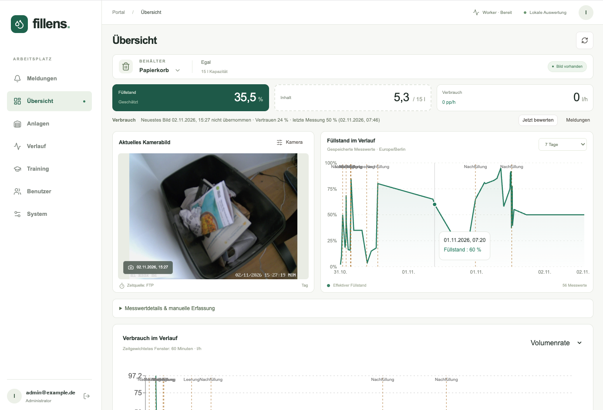
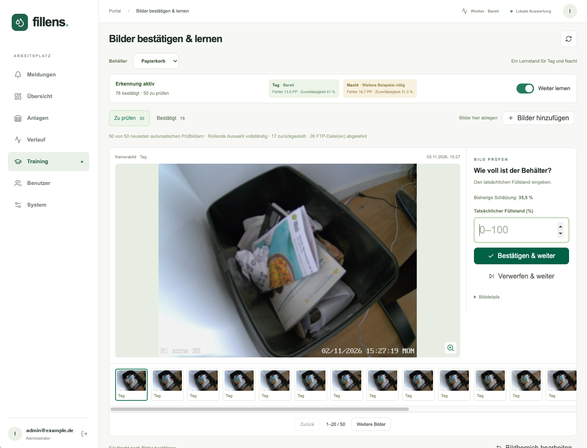
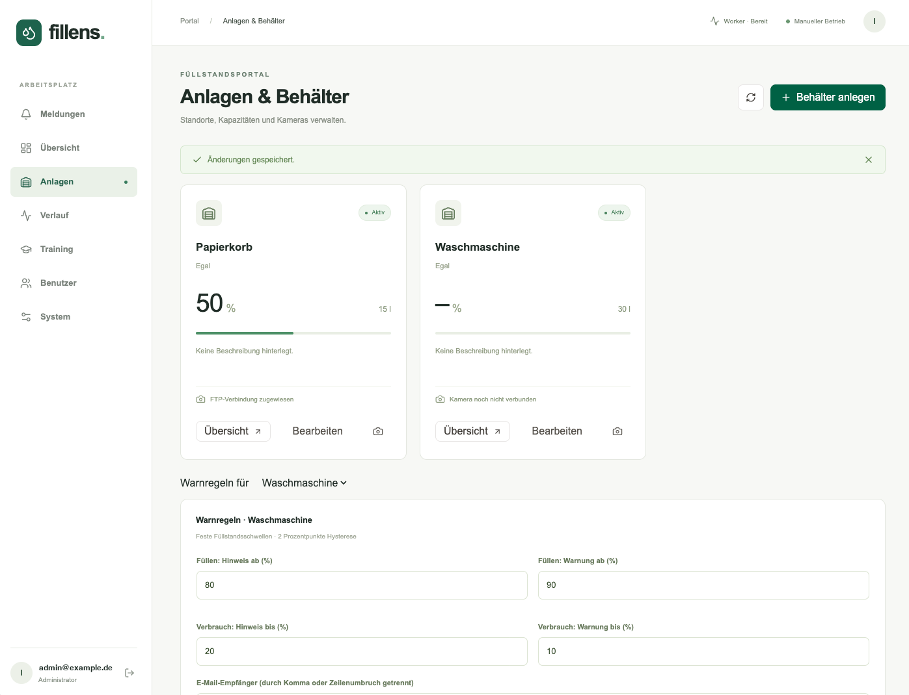

  

<strong>Self-hosted fill level portal</strong> for bins, tanks and containers – camera images, local learning and warnings.

  
  
  
  

<a href="README.md">Deutsch</a> · <a href="docs/SYNOLOGY.md">Synology guide (German)</a> · <a href="CONTRIBUTING.md">Contributing</a>

Fillens is a self-hosted portal for monitoring fill levels of bins, tanks and containers using camera images. Cameras upload pictures via FTP/FTPS; Fillens imports them, records fill levels manually or through a locally trained image model, computes fill/consumption rates and sends warnings in the portal and by e-mail. Everything runs on your own hardware, no cloud service involved.

> The user interface and the detailed documentation are in **German**. This page is a short English overview. Contributions in English are welcome.

## Features

- FTP/FTPS import with date-folder detection, deduplication and a three-image production buffer (no image archive)
- Containers with capacity in litres or m³, one camera per container
- Manual readings plus a local learning model (polygon ROI, day/night, automatic validation before a new model is used)
- Fill or consumption mode with smoothed rates, events (emptying/refill) and threshold warnings via portal and SMTP
- Roles (admin/user), Argon2 passwords, CSRF protection, encrypted FTP/SMTP credentials

<table>
  <tr>
    <td width="50%"></td>
    <td width="50%"></td>
  </tr>
  <tr>
    <td align="center">Confirm images &amp; train the local model</td>
    <td align="center">Containers, capacities and warning rules</td>
  </tr>
</table>

Stack: Next.js/React/TypeScript frontend, FastAPI + SQLAlchemy backend, Python worker, PostgreSQL 17, Docker Compose.

## Install on a Synology NAS

Prebuilt images for `amd64` and `arm64` are published to the GitHub Container Registry:

- `ghcr.io/mumpelmat/fillens-backend`
- `ghcr.io/mumpelmat/fillens-frontend`

1. Create `/volume1/docker/fillens` and copy [deploy/synology/compose.yaml](deploy/synology/compose.yaml) and [deploy/synology/.env.example](deploy/synology/.env.example) (as `.env`) into it.
2. Generate secrets: `openssl rand -hex 32` → `POSTGRES_PASSWORD`, `openssl rand -base64 32 | tr '+/' '-_'` → `ENCRYPTION_KEY`. Keep the encryption key safe.
3. Container Manager → Project → Create → use existing `compose.yaml`.
4. Create the first admin: `sudo docker compose exec backend python -m app.cli create-admin --email admin@example.com`.
5. Put the DSM reverse proxy (HTTPS) in front of `localhost:3000`.

Full step-by-step guide incl. backup and updates (German): [docs/SYNOLOGY.md](docs/SYNOLOGY.md).

## Other Docker hosts and development

On any Docker host you can build from source with `python3 scripts/init_env.py --http && docker compose up -d --build`. Local development setup, tests and configuration reference are in the German [README](README.md) (sections „Lokale Entwicklung“ and „Prüfung und Release“).

## Contributing

See [CONTRIBUTING.md](CONTRIBUTING.md). Please report security issues privately as described in [SECURITY.md](SECURITY.md).

## License

[GNU Affero General Public License v3.0 or later](LICENSE). If you run a modified version as a network service, you must offer its source code to its users.
